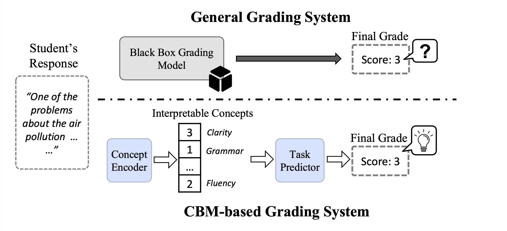
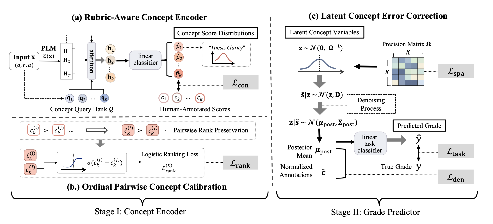

# REC-CBM: Rubric-aware Concept Encoder with Latent Concept Error Correction for Rubric-Graded Text Classification

<p align="center">
  <a href="TODO-paper-url"></a>
  <a href="TODO-arxiv-url"></a>
  <a href="https://github.com/scott-f-zhang/REC-CBM"></a>
</p>

## 🔭 Introduction

Grading open-ended student responses with neural models typically trades interpretability for accuracy: a strong classifier offers no explanation for its grade, while a rubric-based interpretable system loses signal. Concept-bottleneck models (CBMs) close part of this gap by routing predictions through human-meaningful concepts, but existing CBMs are not rubric-aware — concept extractors ignore the structured criteria that human graders actually use, and the concept-to-grade mapping treats noisy concept estimates as if they were ground truth.

<p align="center">
  
  <br/>
  <em>General grading systems vs. CBM-based rubric grading.</em>
</p>

**REC-CBM** addresses both issues. It introduces: RACE, OPCC, and LCEC — detailed below. The model is trained in two stages: Stage I fits the concept encoder; Stage II freezes Stage I and fits an additive residual LCEC correction.

<p align="center">
  
  <br/>
  <em>The REC-CBM framework.</em>
</p>

## ✨ Contribution

- ⭐ **Rubric-Aware Concept Encoder (RACE)** — per-concept attention queries extract dedicated token-level evidence for each rubric criterion instead of routing every concept through a single pooled representation.
- ⭐ **Ordinal Pairwise Concept Calibration (OPCC)** — a pairwise ranking loss `L_rank` added on top of per-concept classification `L_con` to enforce the ordinal structure of rubric scores.
- ⭐ **Latent Concept Error Correction (LCEC)** — treats observed concept scores as noisy measurements of latent true concepts; learns a per-concept observation variance and a precision matrix Ω, and applies a closed-form Gaussian-posterior denoiser (`μ_post`) before the grade classifier.
- ⭐ **Residual 2-stage training** — Stage I trains the concept encoder alone; Stage II freezes Stage I and fits a zero-initialised additive LCEC correction, so Stage II starts from the Stage I baseline and only improves on top of it.
- ⭐ **Consistent empirical gains** across three rubric-graded benchmarks (Mohler short-answer / ASAP essay / MOCHA) and five pretrained backbones (BERT, GPT-2, RoBERTa, T5, BART).

## 🗂️ Repository Layout

```
main.py                         # Single entry point — residual 2-stage

cbm/
  models/models.py              # RubricAwareConceptEncoder, LCECHead, RecCBM,
                                # build_concept_encoder
  models/lcec_residual.py       # LCECResidualHead (additive correction)
  training/trainer.py           # train_one(), save_result_row() — Stage I
  training/lcec.py              # run_stage2() — Stage II LCEC trainer
  training/epoch_loops.py       # train / evaluate / test per epoch
  utils/hyperparams.py          # hyperparams.json loader

dataset/{qa,essay,mocha}/       # Train/dev/test splits
cbm/data/{qa,essay,mocha}.py    # Torch datasets
config/hyperparams.json         # Stage I hyperparameters per (dataset, model)
                                # (lr, attention_temperature, λ_rank)
assets/                         # Figures used by this README
data/cbm_results_<dataset>/     # Training result CSVs (gitignored)
```

## 📦 Installation

```bash
python -m venv .venv && source .venv/bin/activate
pip install -r requirements.txt
```

Requires Python 3.9+ and PyTorch with CUDA for GPU training.

## 🚀 Usage

Residual 2-stage on `qa` / `gpt2` (auto-trains Stage I CONCEPT_ENCODER on first run and caches it under `saved_models/`; Stage II reuses the cached checkpoint afterwards):

```bash
python main.py --dataset qa --model gpt2
```

Supported values:

- `--dataset {qa, essay, mocha}`
- `--model {bert-base-uncased, gpt2, roberta-base, t5-base, facebook/bart-base}`
- `--seed <int>` — default `123`

Results are written to:

```
data/cbm_results_<dataset>/seed_<seed>/
  concept_encoder/<dataset>/result_<dataset>.csv   # Stage I
  rec_cbm_2stage/<dataset>/result_<dataset>.csv    # Stage II
```

Stage I hyperparameters (`lr`, `attention_temperature`, `λ_rank`, `query_lr_multiplier`) live in `config/hyperparams.json` and are loaded via `cbm.utils.hyperparams.get_method_params`. Stage II hyperparameters (`lr`, `λ_den`, `λ_spa`) live in `STAGE2_PARAMS` inside `cbm/training/lcec.py`.

## 📊 Datasets

REC-CBM is trained on three public grading benchmarks — Mohler short-answer (`qa`), ASAP 2.0 essay (`essay`), and MOCHA (`mocha`) — each re-annotated with an ordinal rubric-concept inventory designed by three domain experts and labelled via a human-in-the-loop pipeline (GPT-4o + Gemini-2.5-pro propose → expert review, majority-vote disagreement resolution). Higher concept scores mean better, and levels are non-interpolated.

| Dataset | Concepts (K)                            | Task classes |
|---------|-----------------------------------------|--------------|
| qa      | FC, CC, TU, CP, R, DU, EE, FR (8)       | 6 (0–5)      |
| essay   | TC, UE, OC, GM, VA, SV, CTD, FR (8)     | 6 (0–5)      |
| mocha   | RQ, IA, TG, CR, PQ, C, CC (7)           | 5 (0–4)      |

We release only the **join keys + our concept annotations** on [Hugging Face](https://huggingface.co/datasets/scott-f-zhang/REC-CBM) (raw text cannot be redistributed under the upstream licenses). Download the upstream archives (ASAP 2.0 / Mohler / MOCHA) into `rawdata/` and run the release's `merge_with_raw.py` to rebuild the full train / dev / test splits expected by `cbm/data/{qa,essay,mocha}.py`.

## 📝 Citation

```bibtex
@article{reccbm2026,
  title={REC-CBM: Rubric-aware Concept Encoder with Latent Concept Error Correction for Rubric-Graded Text Classification},
  author={TBD},
  journal={TBD},
  year={2026}
}
```

## License

Released under the MIT License — see `LICENSE`.
